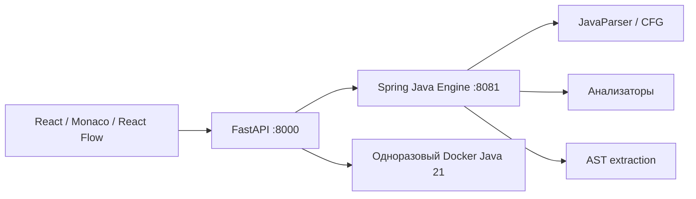

# Mirutex IDE

Веб-среда команды **Mirutex VMO** для кейса AXENIX: загрузить Java-монолит, исследовать граф выполнения, найти потенциальные дефекты, изменить код или поддерживаемые узлы, выделить компонент и сравнить поведение программ в Java 21.

## Опубликованная версия

**https://193.233.247.61/** — логин `user`, пароль не нужен. Это демо: редактор Java, граф, анализ, снимки и экспорт. Выполнение Java и преобразования с компиляцией доступны через защищённое пространство `/admin/` с прежними учётными данными. Локальный `/admin/` работает без HTTP Basic, поскольку dev-сервисы слушают loopback; контроль публичного доступа задаёт host Nginx, не клиентская форма.

Новые инструменты: палитра команд `Ctrl/⌘ Shift P` (действия, методы, узлы), карта методов, линза изменений относительно baseline, режим фокуса и просмотр файлов компонентов. [Отчёт обновления](docs/STUDIO_UPDATE.md).

Новая блок-схема использует ромбы для условий/циклов, параллелограммы ввода-вывода и отдельные боковые линии возврата. [Финальная перепроверка по критериям, 83 теста](docs/FINAL_CRITERIA_AUDIT.md). [Скриншоты схемы](output/screenshots/flowchart-final/index.html). Пример: `examples/FlowchartDemo.java`.

## Быстрый запуск

Нужны JDK 21, Python 3.12+, Node.js 22.12+ и работающий Docker Engine / Docker Desktop / Colima. На macOS скрипт автоматически выбирает установленный JDK 21. Порты 5173, 8000 и 8081 должны быть свободны.

```sh
# Только если используется Colima и она ещё не запущена:
colima start --cpu 2 --memory 4

./run.sh
```

Скрипт загружает официальный образ `eclipse-temurin:21-jdk`, собирает Java-модули с тестами, устанавливает зависимости Python и frontend, проверяет frontend production build и запускает три сервиса. Maven устанавливается локально через wrapper с проверкой SHA-512. Первая сборка требует доступа к Maven Central, npm, PyPI и Docker Hub.

- Приложение: **http://127.0.0.1:5173**
- OpenAPI / Swagger: **http://127.0.0.1:8000/docs**
- Состояние: **http://127.0.0.1:8000/health**
- Ctrl+C останавливает запущенные супервизором процессы.
- Повторный запуск без установки и сборки: `./run.sh --no-build`.
- Логи: `.runtime/engine.log`, `.runtime/api.log`, `.runtime/frontend.log`.

Не запускайте второй экземпляр поверх уже работающих сервисов. Сохранённые проекты находятся в localStorage браузера; экспортируйте важный код в файл.

## Docker Compose

```sh
docker pull eclipse-temurin:21-jdk
# Linux / Docker Desktop:
docker compose up --build
# Если Compose установлен отдельной командой, используйте docker-compose.
# macOS с Colima использует тот же /var/run/docker.sock внутри VM:
docker-compose up --build
```

Приложение доступно на том же адресе http://127.0.0.1:5173. Java-тесты запускаются **в стадии сборки engine-контейнера**, frontend проверяется TypeScript и Vite внутри контейнера. Проверки состояния задают порядок запуска. Остановка: `docker compose down` (или `docker-compose down`).

Backend использует Docker socket для создания одноразовых контейнеров. Это конфигурация локальной хакатонной демонстрации: socket даёт API-сервису полномочия Docker daemon. Для публичного multi-tenant размещения нужен отдельный worker/daemon, аутентификация, очередь и ограничение запросов. Интернет-публикация не настраивалась.

## Возможности

- JavaParser с уровнем языка Java 21; классы, интерфейсы, поля, конструкторы и методы.
- Граф управления потоком: ветви, условия, `for`, enhanced `for`, `while`, `do`, `switch` с fall-through, `break`, `continue`, `return`, `throw`.
- Java → граф → Java без изменения символов исходника, если граф не редактировали. Привязка к строкам и UTF-16 диапазонам; сохранение кириллицы, комментариев, табуляций, CRLF.
- Замена выражений/операторов, вставка перед оператором внутри блока, удаление обычного оператора. Сервер заново строит AST, проверяет структуру и **компилирует результат** перед принятием изменения через API.
- Сохранены восемь анализаторов Ивана: сложность, повторные вычисления, дубли, деление на ноль, возможный null, границы массивов, недостижимый код и потенциально бесконечные циклы. Диагностика содержит строку, узел, объяснение и рекомендацию.
- AST-рефакторинг самостоятельных `private static` методов в отдельный компонент с делегирующими обёртками; предпросмотр diff, все выходные файлы, компиляция и тесты до разрешения применения, откат через снимки.
- Java assist: контекстное меню подсказок, локальные переменные и методы, Java-шаблоны (`sout`, `psvm`, `fori`), типовые методы System/Math/String/коллекций. Tab — принять, Ctrl+Space — вызвать, Escape — закрыть. Это локальные подсказки, без Java LSP.
- Стабильное перетаскивание узлов без пересборки раскладки и скачков камеры; позиции сохраняются при переключении темы и методов в текущей сессии. Плавные переходы учитывают reduced motion.
- Monaco Editor и React Flow: выбор метода, переход между кодом и узлами, перемещение/масштабирование, minimap, автоматическая компоновка, изменяемая ширина, полный экран графа, светлая и тёмная темы.
- Сравнение реальных stdout, stderr и exit code на одинаковых входах; отдельные статусы компиляции, ошибки запуска, timeout и ограничения вывода.
- Автосохранение, до 20 снимков проекта, экспорт `.java` или ZIP многофайлового результата.
- Горячие клавиши: Cmd/Ctrl+K — анализ; Cmd/Ctrl+Enter — компиляция; Cmd/Ctrl+S — экспорт; Escape — закрыть выбранный узел.

## Архитектура и структура

```text
frontend/        React 19, TypeScript, Monaco, React Flow, Dagre, Vite
backend/         FastAPI: общий API, загрузка/выгрузка, Docker runner, quality gate
core/            Java 21 + JavaParser: AST, source-backed CFG, изменения и валидация
analyzer/        Spring Boot: Java engine API и существующие анализаторы
refactoring/     AST-фасад для web + сохранённый первоначальный CLI команды
examples/        ScopeShowcase.java и MonolithDemo.java (1430 строк)
testing/         Реальные HTTP/Docker интеграционные тесты и общий запуск проверок
infrastructure/  Dockerfiles и nginx
scripts/         Локальный супервизор запуска
docs/           Аудит, API-контракт, scope, сценарий и результаты проверок
pom.xml          Единая Maven multi-module сборка Java
mvnw             Maven 3.9.9 wrapper, JDK 21
run.sh           Основная команда локального запуска
docker-compose.yml  Воспроизводимая контейнерная конфигурация
```



Maven сохранён вместо миграции на Gradle: оба исходных Java-модуля уже использовали Maven. Ненужная замена системы сборки не улучшила бы функциональность. FastAPI Владислава сохранён и расширен, полезные Java-анализаторы переиспользованы.

## Проверки

При работающем приложении:

```sh
./testing/run-tests.sh
```

По отдельности:

```sh
./mvnw -B -ntp test
PYTHONPATH=backend .venv/bin/pytest backend -q
npm --prefix frontend test
npm --prefix frontend run build
.venv/bin/pytest testing/test_integration.py -q -s
npm --prefix frontend audit
```

JUnit проверяет AST/CFG, неизменённый roundtrip, стабильность ID при замене, переходы break/continue, безопасные и запрещённые операции, синтаксические ошибки, Unicode/CRLF, большой монолит, компиляцию тестовых примеров, refactoring и JSON-контракт engine. Только собственные фиксированные QA-примеры компилируются локальным JavaCompiler в JUnit; загружаемый пользователем код компилируется и исполняется через Docker.

`backend/test_app.py` — unit-тесты API с mock runner: они не являются доказательством работоспособности Docker. `testing/test_integration.py` — реальные вызовы HTTP, javac и Java в контейнерах, сравнение поведения, рефакторинг 100 методов, ZIP, неверный код, бесконечный цикл, переполнение вывода, блокировка сети/host filesystem и проверка ресурсных ограничений.

Фактически полученные результаты и ограничения среды зафиксированы в [docs/VERIFICATION.md](docs/VERIFICATION.md). Статусы не подменяются фиктивными успешными результатами.

## Поддержка и ограничения

Полная матрица официального PDF: [docs/REQUIREMENTS.md](docs/REQUIREMENTS.md).

1. Граф внутрипроцедурный. Библиотечные вызовы, выражения и выделенные методы показаны атомарно. Типы и зависимости вызовов не разрешаются symbol solver.
2. `try/catch/finally`, labelled и synchronized блоки **сохраняются**, компилируются и исполняются, но визуально представлены атомарным регионом с возможным нормальным/аварийным завершением. Их внутренние переходы и редактирование отдельных вложенных узлов пока не реализованы. Инициализаторы классов сохранены в коде без отдельного CFG. Это частичная визуальная поддержка, а не полноценная модель исключений.
3. Произвольное перетаскивание связей, перестройка циклов и перенос операторов между областями видимости запрещены. Перемещение узла на экране меняет только визуальную позицию. ID основаны на пути конструкции: стабильны при повторном разборе и замене содержимого, могут меняться при вставке/удалении предшествующих конструкций.
4. Рефакторинг ограничен самостоятельными private static методами без собственных полей, вызовов методов исходного класса, пользовательских типов исходного файла, generic-параметров и локальных/анонимных классов. Произвольное выделение блока в метод и автоматическая декомпозиция stateful-классов не реализованы. Повторное выделение из многофайлового результата отклоняется.
5. Big O — предварительная структурная оценка. Циклы с неизвестными границами/while/рекурсией могут давать UNKNOWN; вызовы библиотек и межпроцедурные зависимости не учитываются. Наличие/отсутствие предупреждений не доказывает дефект/корректность.
6. Успешная компиляция не равна успешному тесту. Совпадение на конечном наборе входов **не доказывает** эквивалентность всех возможных поведений. Не сравниваются время, память, порядок фоновых потоков и внешние эффекты. Нестабильный вывод и изменившиеся номера строк в stack trace могут приводить к расхождению.
7. На один сценарий: 15 секунд, 1 CPU, 384 MiB container RAM, Java heap 96 MiB, 128 процессов/потоков, 100 KB stdout и stderr, read-only root, tmpfs, сеть выключена, без host mounts и Linux capabilities. До двух одновременных запусков. Контейнер удаляется после timeout/лимита вывода. До 10 входов, 20 файлов, 256 KB исходника / 512 KB проекта.
8. Загрузка принимает один исходный `.java`; дополнительные файлы появляются через рефакторинг/API. Нет Java language server: Monaco подсвечивает Java, предлагает локальные дополнения и показывает результаты анализа, полная проверка типов выполняется javac.
9. В первоначальном каталоге не было `.git`; новый репозиторий не создавался, внешние remotes/публикация не менялись. Качественные исходные реализации сохранены.

## Обновление интерфейса

[Результаты проверки Mirutex IDE](docs/IDE_UPDATE.md). [12 скриншотов с подписями](output/screenshots/mirutex-ide/README.md), [HTML-галерея](output/screenshots/mirutex-ide/index.html), [ZIP всех снимков](output/screenshots/mirutex-ide-screenshots.zip).

## Демонстрация

Пошаговый сценарий: [docs/DEMO.md](docs/DEMO.md).

Кратко: загрузить `examples/MonolithDemo.java` → исследовать `main` → анализ вложенных циклов → поддерживаемое изменение `int pairs = 0;` на `int pairs = 0 + 0;` → компиляция → сравнение на входах `5`, `0`, `-2` → предпросмотр рефакторинга → применить проверенное выделение 100 методов → скачать ZIP → при необходимости восстановить снимок.

## Команда Mirutex VMO

| Участник | Ответственность |
|---|---|
| Михаил Савченко | Team Lead, Core Engine, Architecture, Integration |
| Иван Колотий | Code Analysis |
| Сергей Кулабухов | Refactoring |
| Аким Петрушечкин | Frontend, UI/UX |
| Владислав Мальцев | Backend, API |
| Илья Самарин | QA, Testing |
